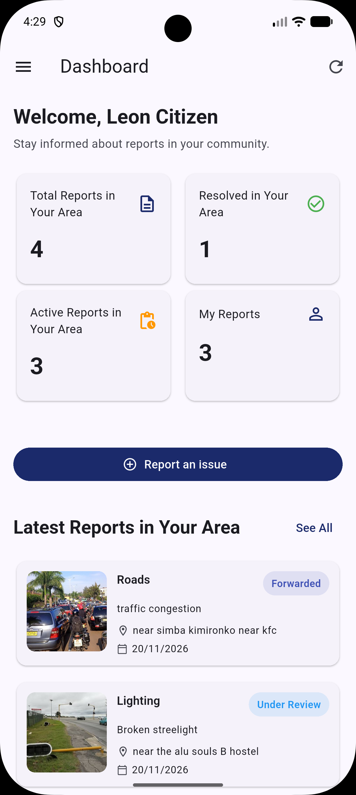
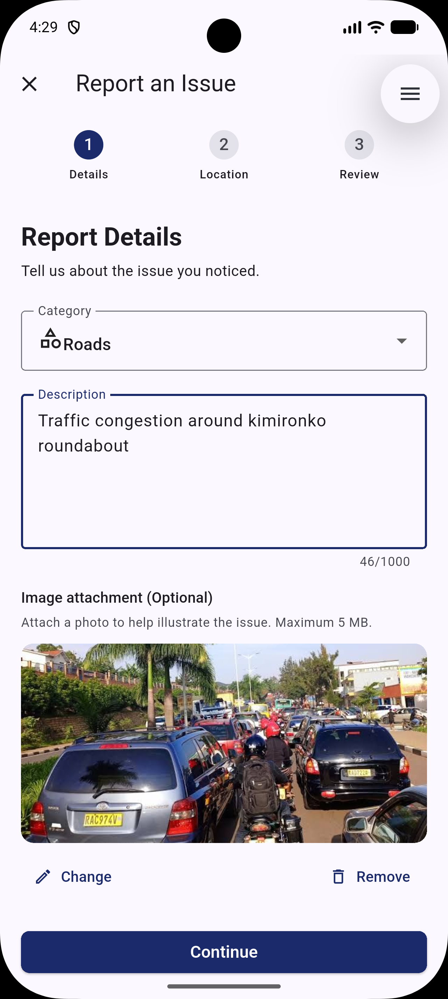
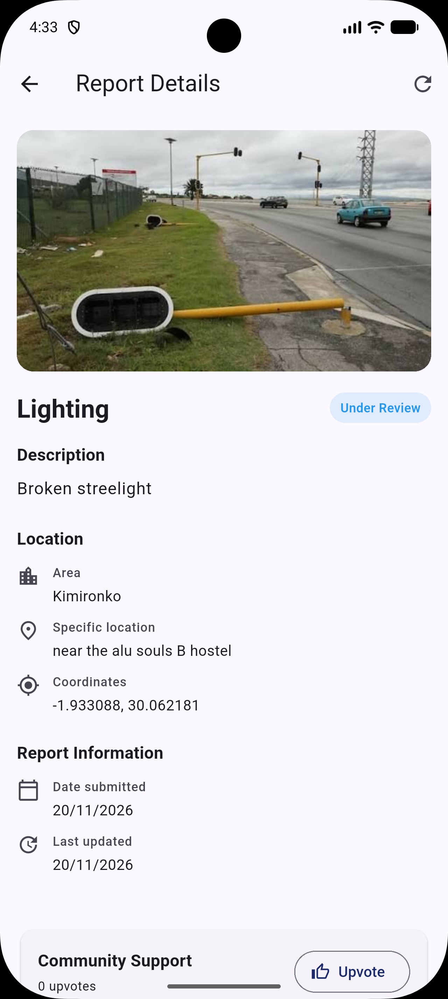
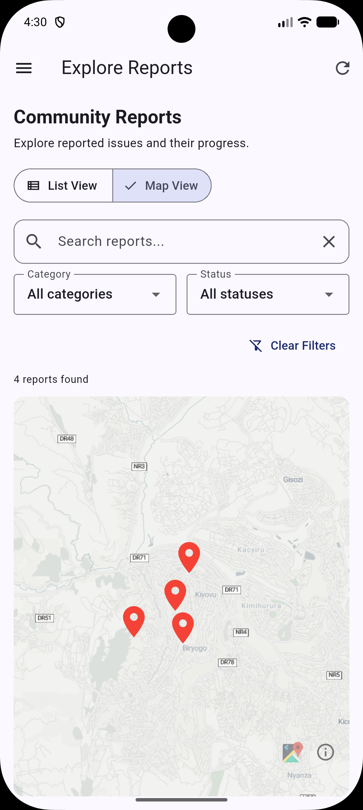
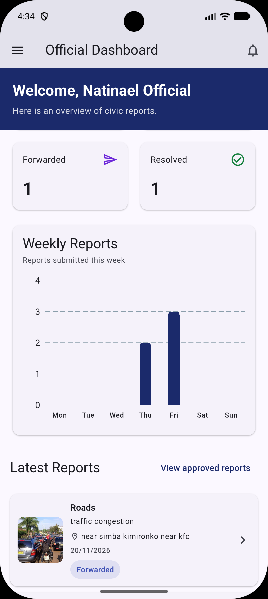
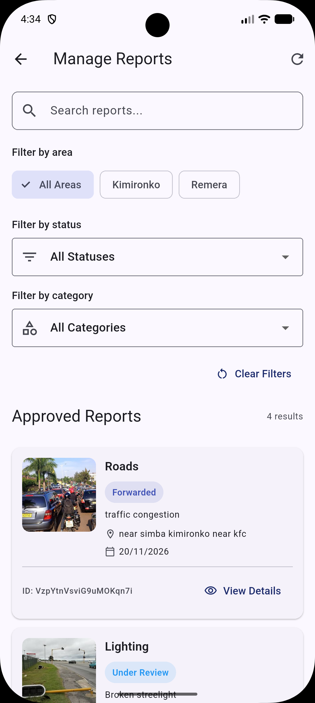
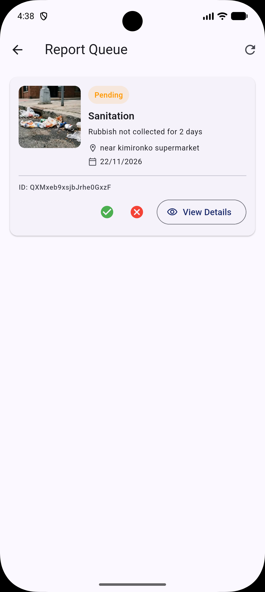
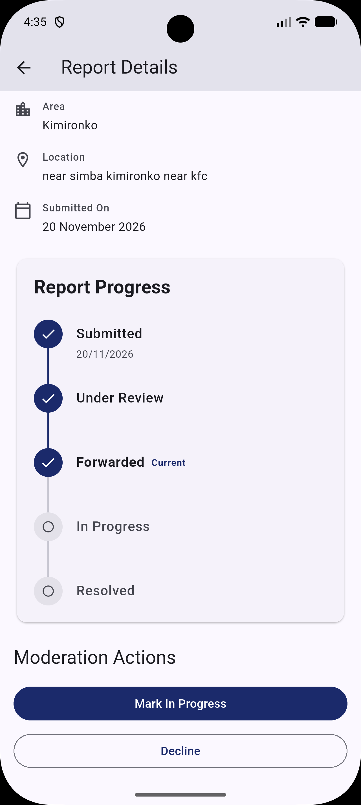

# Raporta - Civic Issue Reporting Application
A mobile platform for reporting, tracking, and managing civic issues in Kigali, Rwanda. 
The application enables citizens to report infrastructure and public-service issues, track their progress, and engage with community reports. 
Designated officials can review submissions, manage report statuses, and forward issues to relevant agencies.
The initial implementation focuses on Kimironko and Remera, Kigali.

## 1. Project Deliverables
- Demo Video: In progress
- Release APK: In progress
- [**Final Project Report**](https://docs.google.com/document/d/1QA_W_lZFxNjiEKgVZ-R2DgpS38clrmVTCOt380G9q44/edit?usp=sharing)
- [**Entity Relationship Diagram**](https://drive.google.com/file/d/1JNqiCVqHo3U0s_VY3rtRTkPW2bGEXkEJ/view?usp=sharing)
- [**Figma Prototype**](https://www.figma.com/design/hAHAg2h13itYEGSr6OCFF0/User-Research---Design-Figma-Board?node-id=0-1&t=kP0M9SphVV2D6z1u-1)
- [**User Research & Deisgn Document**](https://docs.google.com/document/d/1KDcjZIgV6dKNcjV2YUlAwMGymKnns-RSHKlMvd7kaKY/edit?usp=sharing)
- [**Team task sheet**](https://docs.google.com/spreadsheets/d/1HEGal00BuWT2rK6NJWo6LA3EGwtchP18HFAc5k9tXhA/edit?usp=sharing)

## 2. Project Objectives
- Provide a simple and accessible interface for reporting civic issues
- Support accurate issue identification through map-based location selection
- Enable officials to review, approve, decline, and manage reports
- Improve transparency through report-status tracking and notifications
- Encourage community engagement through public reports and upvotes
- Implement secure authentication and role-based access using Firebase

## 3. Application Screenshots

## Application Screenshots

<h3>Citizen Experience</h3>

<table>
  <tr>
    <th>Citizen Dashboard</th>
    <th>Report Submission</th>
    <th>Explore Reports</th>
    <th>My Reports</th>
  </tr>
  <tr>
    <td></td>
    <td></td>
    <td></td>
    <td></td>
  </tr>
</table>

<h3>Official Experience</h3>

<table>
  <tr>
    <th>Official Dashboard</th>
    <th>Report Queue</th>
    <th>Report Management</th>
    <th>Report Details</th>
  </tr>
  <tr>
    <td></td>
    <td></td>
    <td></td>
    <td></td>
  </tr>
</table>

## 4. Tech Stack
| Technology | Purpose |
| :--- | :--- |
| Flutter and Dart | Mobile application development |
| flutter_bloc | BLoC/Cubit state management |
| Firebase Authentication | Email/password and Google authentication |
| Cloud Firestore | Application database |
| Firebase Security Rules | Database authorization and access control |
| Cloudinary | Optional report photo uploads |
| flutter_map | Interactive maps |
| Stadia Maps / OpenStreetMap | Map tiles and geographic data |
| GetIt | Dependency injection |
| GoRouter | Navigation and role-based routing |
| SharedPreferences | Persistent local user preferences |
| fl_chart | Dashboard statistics visualization |

## 5. Architecture
### Presentation Layer
Contains Flutter pages, reusable widgets, BLoCs, Cubits, and UI states. BLoC and Cubit manage asynchronous operations 
and application state, including authentication, reports, moderation, notifications, and dashboard information.

### Domain Layer
Contains entities, repository contracts, and use cases describing the application's business operations.

### Data Layer
Contains repository implementations, models, and remote data sources. 
This layer communicates with Firebase Authentication, Cloud Firestore, and external services such as Cloudinary.

### Supporting Components
- **GetIt:** Registers and resolves application dependencies
- **GoRouter:** Manages navigation and restricts citizen and official routes.
- **Shared widgets:** Provide reusable cards, buttons, navigation components, and status indicators.

## 6. Database Design
| Collection | Purpose |
| :--- | :--- |
| users | Citizen and official profiles |
| areas | Supported reporting areas |
| agencies | Agencies associated with civic issue categories |
| reports | Submitted issues, locations, statuses, and moderation information |
| notifications |In-app notifications for relevant events |
| app_config | Application-level configuration |

Reports also contain two subcollections:
- reports/{reportId}/upvotes/{userId}
- reports/{reportId}/upvote_notification_markers/{userId}

The second subcollection prevents repeated upvote notifications from the same user for the same report.
The ```app_config/moderation``` document identifies the designated official who 
receives notifications about newly submitted reports.

## 7. Getting Started
### Prerequisities
- Flutter SDK and Dart.
- Android Studio or VS Code with Flutter extensions.
- Android SDK and a configured emulator or Android device.
- Git.
- Access to the configured Firebase project.
- The required external-service configuration.

### Clone the repository
```
  git clone https://github.com/L-nsamba/raporta_summative.git
  cd raporta_frontend_backend_implementation
```

### Install Dependencies
```
  flutter pub get
```

### Firebase Configuration
Raporta requires a Firebase project configured with:
- Firebase Authentication.
- Email/password and Google authentication providers.
- Cloud Firestore.
- The appropriate Firestore security rules and indexes.

The appropriate Firestore security rules and indexes.
The Firebase Android application must use the correct package identifier:
```com.raporta.app```

Ensure that the Firebase Android configuration files are available and
that required SHA fingerprints are registered for Google Sign-In.

### Stadia Maps Configuration
Create a .env.json file in the project root (Do not commit):
```
  {
    "STADIA_MAPS_API_KEY": "YOUR_STADIA_MAPS_API_KEY"
  }
```

### Cloudinary Configuration
Configure the Cloudinary cloud name and upload preset according to the 
application's existing photo-upload configuration. Photo uploads are optional for citizens, 
but the Cloudinary configuration is required to use this feature.

### Run the Application
```
  flutter run --dart-define-from-file=.env.json
```

Select a connected Android device or emulator.

### Build the Release APK
```
  flutter build apk --release --dart-define-from-file=.env.json
```

The APK is normally generated at:
```
  build/app/outputs/flutter-apk/app-release.apk
```

## 8. Testing and Quality Assurance
Testing is used to verify the application's business logic, presentation components, 
database security, and functionality.

### Automated Testing
The project includes tests covering areas such as:
- Authentication behavior
- Report creation and validation
- Repository and use-case logic
- Report status handling
- Upvote behavior
- Soft deletion
- BLoC/Cubit state transitions
- Firestore Security Rules

Widget tests additionally verify rendering and interactions for shared application components.

### Run Tests
```
  flutter test
```

Generate a coverage report:
```
  flutter test --coverage
```

### Code Analysis
```
  flutter analyze
```

### Code Formatting
```
  dart format lib test
```
### Manual Testing
Manual testing covers the main citizen and official workflows, including report submission, map selection, 
photo uploads, moderation, report tracking, notifications, and navigation. Testing results and supporting screenshots are 
documented in the final project report.

## 9. Team and Collaboration
| Member | Role |
| :--- | :--- |
| Leon Nsamba | Citizen workflow |
| Manuelle Ackun | Authentication and Shared Preferences |
| Natinael Borana | Official workflow |

## 10. Known Limitations and Future Work
- Expanding support beyond Kimironko and Remera
- Introducing push notifications in addition to in-app notifications
- Enhancing reporting analytics and geographical visualization
- Adding advanced moderation and reporting capabilities
- Improving integration with external agencies


